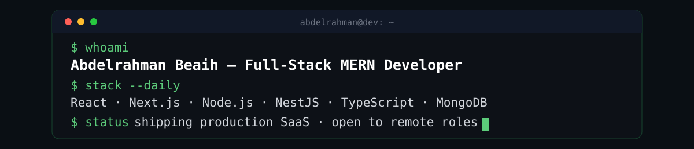
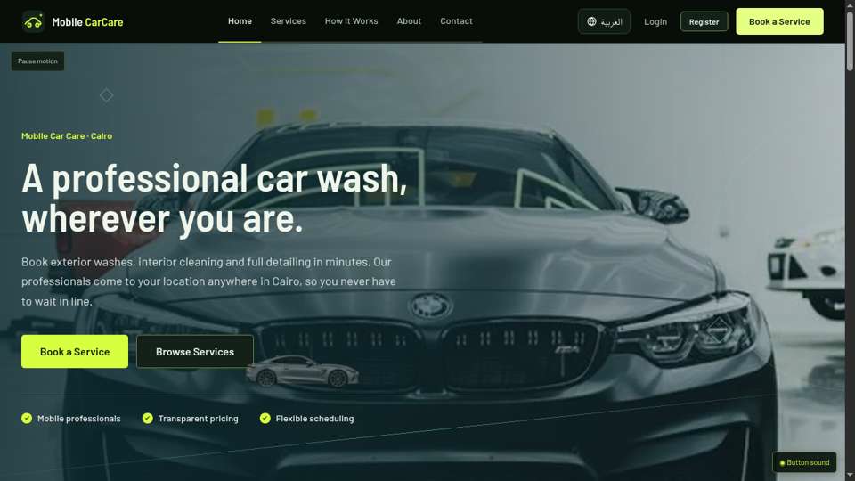

## About me

Full-stack developer from Egypt, building production web apps with the MERN stack. Currently a full-stack developer at **SpaceTech**, working on **Nawy Orders**, a live SaaS ordering platform. I also freelance — recent client work includes a bilingual freelance-services platform and a full-stack mobile car care booking app. I care about clean UI, bilingual (English/Arabic, RTL) experiences, and code that survives production.

- Working daily in **React, Next.js, Node.js, NestJS, TypeScript and MongoDB**
- Experienced with **Redux Toolkit, Zustand, Tailwind CSS** and REST API design
- I build **bilingual EN/AR interfaces** with proper RTL support
- Open to full-time MERN / front-end roles — Cairo, on-site or remote

 

## Right now

- Shipping features on **Nawy Orders**, a production SaaS platform, with the team at SpaceTech
- Freelancing on full-stack client platforms (bilingual EN/AR)
- Leveling up toward **international remote roles** — deepening NestJS, system design and English every day

## Tech stack

**Core**

**State, styling and tooling**

## Featured projects

<table>
  <tr>
    <td width="50%">
      
      <b>Nawy Orders</b> — production SaaS ordering platform (team work at SpecTech) 
      <code>React</code> <code>Node.js</code> <code>Express</code> <code>MongoDB</code> 
      <a href="https://www.nawyorders.com/en">Live</a>
    </td>
    <td width="50%">
      
      <b>Mobile Car Care</b> — car-wash booking and management system: online booking, admin dashboard and analytics, EN/AR 
      <code>Next.js</code> <code>NestJS</code> <code>TypeScript</code> <code>MongoDB</code> 
      <a href="https://mobilecarcare.vercel.app">Live</a> · <a href="https://github.com/Abdobeaih/Car-Wash">Code</a>
    </td>
  </tr>
  <tr>
    <td width="50%">
      
      <b>Mustakileen</b> — bilingual freelance-services platform, shipped for a client 
      <code>React</code> <code>Express</code> <code>MongoDB</code> <code>Zustand</code> 
      <a href="https://frontend-project-ed-xrvo.vercel.app">Live</a> · <a href="https://github.com/Abdobeaih/mustakileen">Code</a>
    </td>
    <td width="50%">
      
      <b>Karam El Sham</b> — restaurant app: dynamic menu, cart, search and filters 
      <code>React 19</code> <code>Redux Toolkit</code> <code>Tailwind</code> 
      <a href="https://karam-el-sham-restaurant-sigma.vercel.app">Live</a> · <a href="https://github.com/Abdobeaih/karam-el-sham">Code</a>
    </td>
  </tr>
  <tr>
    <td width="50%">
      
      <b>TaskFlow</b> — task manager: statuses, priorities, projects and tags 
      <code>React 19</code> <code>TypeScript</code> <code>Material UI</code> 
      <a href="https://todo-list-react-2jmz.vercel.app">Live</a> · <a href="https://github.com/Abdobeaih/TodoListReact">Code</a>
    </td>
    <td width="50%">
      
      <b>My portfolio</b> — interactive 8-station journey-map portfolio, EN/AR 
      <code>React</code> <code>TypeScript</code> <code>Three.js</code> <code>Vite</code> 
      <a href="https://abdelrahman-beaih-portfolio.vercel.app">Live</a> · <a href="https://github.com/Abdobeaih/Abdelrahman-Beaih-Portfolio">Code</a>
    </td>
  </tr>
</table>

## GitHub analytics

## Contribution snake

<picture>
  <source media="(prefers-color-scheme: dark)" srcset="https://raw.githubusercontent.com/Abdobeaih/Abdobeaih/output/github-contribution-grid-snake-dark.svg"/>
  
</picture>

<i>Open to full-time MERN / front-end roles. The fastest way to reach me is <a href="https://www.linkedin.com/in/abdelrahman-beaih">LinkedIn</a> or <a href="mailto:abdobeaih43@gmail.com">email</a>.</i> 
<i>If something here caught your eye, a follow or a star on a repo you like means a lot. Curious about my year in code? <a href="https://skyline.github.com/Abdobeaih">See it in 3D</a>.</i>

